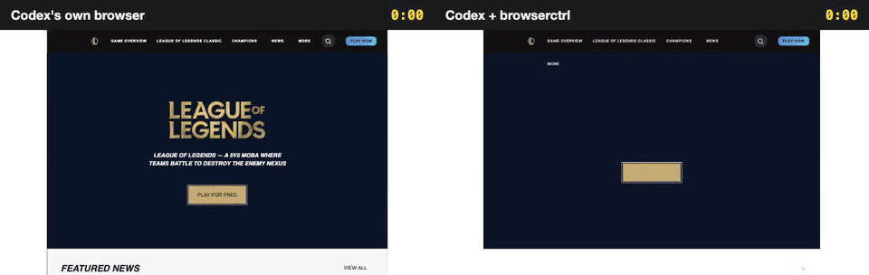
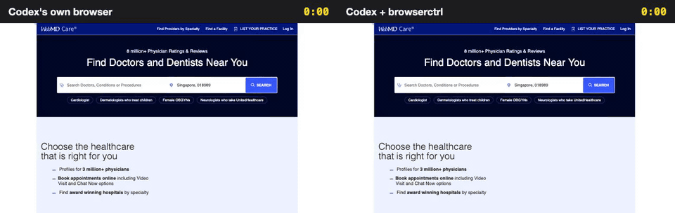
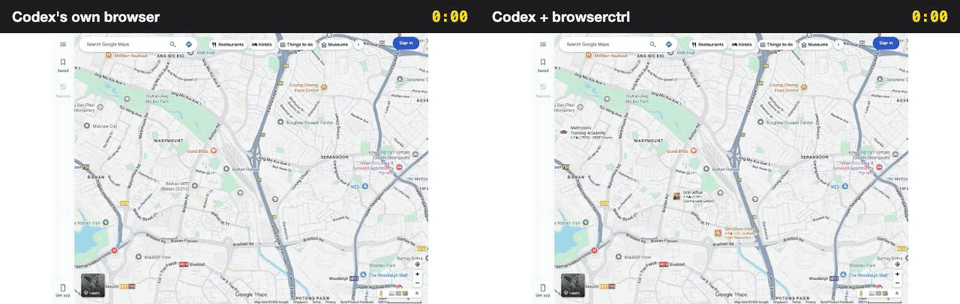
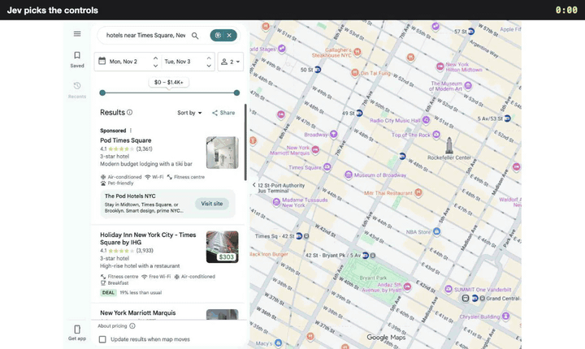
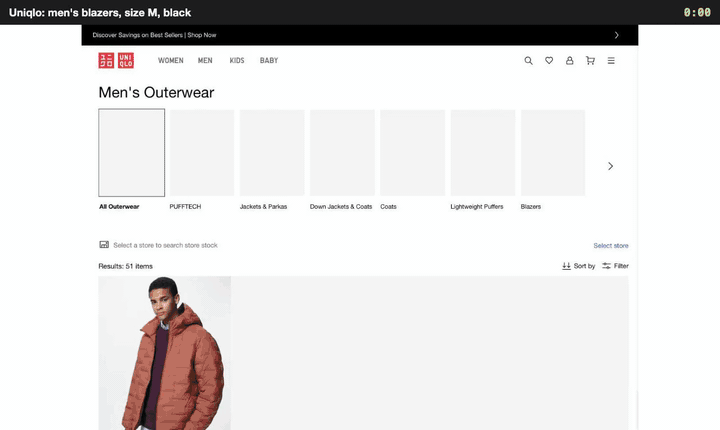
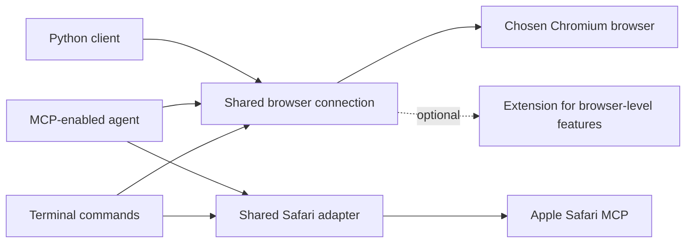

# browserctrl

[](https://github.com/seahyc/browserctrl/actions/workflows/test.yml)
[](LICENSE)

**browserctrl lets an AI use websites for you: the fiddly ones with filters, calendars, sliders and fine print. On 21 hard tasks on websites it had never seen, it got as many right as Codex's own built-in browser, finished them faster, and read a third less.**


*The same AI, on its first try, on a site neither side had seen before. The task: "Identify the ongoing competition that offers the highest prize and find the code that received the most votes in that competition." Left: Codex using its own browser, 3 min 25 s. Right: the same Codex using browserctrl, 1 min 40 s. Shown 4× faster; [watch it in real time](docs/media/kaggle-side-by-side.mp4).*

| 21 hard tasks on 17 sites it had never seen | Codex's own browser | Codex + browserctrl |
| --- | --- | --- |
| Tasks done right (checked by hand) | 17 | **18** |
| Time on the 15 tasks both got right | 45.8 min | **40.0 min** |
| Typical (median) task | 2 min 48 s | **2 min 20 s** |
| Faster on | 6 of the 15 | **9 of the 15** |
| Text the AI had to read (tokens) | 17.7 million | **11.9 million** |

Same AI model (`gpt-6.1-sol`, low reasoning), same browser, same machine, one try each. [How we kept it fair](#how-we-kept-it-fair), [where it lost](#where-it-lost), and [every run](docs/results/om2w-2026-10.runs.md).

## What it does, in plain words

Think of browserctrl as a better pair of hands for an AI that uses the web.

- **It does several steps in one go.** Instead of looking at the whole page before every click, the AI writes a short plan: *open Filter, pick size M, pick Black, show the results*. browserctrl carries it out and only stops if something looks wrong.
- **It tells the AI what changed.** After a plan it reports what is different on the page ("Results: 51 items → 3 items", "Black: now ticked"), so the AI doesn't have to read the whole page again to find out.
- **It handles the fiddly parts.** Calendars, sliders, plus and minus buttons, small checkboxes, menus that only appear when clicked, controls hidden inside other components, and pop-ups that get in the way.
- **It checks its own work.** If a box didn't tick or the page shows an error, it stops and says so. When it isn't sure it picked the right button, it says that too.
- **It never pays for you.** It won't press Buy, Pay, Book or Send unless it is told to in so many words.
- **It skips the clicking when it can.** For sites it knows, a *recipe* asks the site for the information directly: a whole Shopee order history comes back in about 7 seconds instead of minutes of scrolling.
- **It keeps a small recording of every run,** about 1 MB, which you can watch later as a video like the ones on this page.

## Watch it on different kinds of websites

Every clip below is a real benchmark run on a site browserctrl had never been tuned on, with Codex's own browser on the left and Codex with browserctrl on the right, on one shared clock.

| | Task | Codex's own browser | Codex + browserctrl |
| --- | --- | --- | --- |
| 🎮 [League of Legends](docs/media/leagueoflegends-side-by-side.mp4) | "Browse the final skin in the list for the champion Ahri." | 3:37 | **1:19** |
| 🩺 [WebMD doctors](docs/media/webmd-doctors-side-by-side.mp4) | "Find the best audiologist within 50 miles of New York with a rating of 4 and above." | 2:48 | **1:02** |
| 📊 [Kaggle](docs/media/kaggle-side-by-side.mp4) | The highest-prize competition and its most-voted code. | 3:25 | **1:40** |
| 🎓 [Stanford](docs/media/stanford-side-by-side.mp4) | "Graduate-level chemistry courses on Monday afternoons in the winter of 2023." | 3:28 | **2:01** |
| 🗺️ [Google Maps](docs/media/googlemaps-side-by-side.mp4) | The top-rated Manhattan hotel for 4 guests, and the fastest transit from it to LaGuardia. | 5:55 | **3:42** |
| ✈️ [FlightAware](docs/media/flightaware-side-by-side.mp4) | United or American flights from London arriving in New York between 8 and 11 PM. | **2:32** | 5:05 |
| 🏦 [Chase](docs/media/chase-side-by-side.mp4) | How much a 401(k) grows from age 22 to 65 at 3% with $8,000 + $8,000 a year. | **2:24** | 4:50 |

<table><tr>
<td></td>
<td></td>
</tr><tr>
<td colspan="2"></td>
</tr></table>

### Where it lost

**Chase:** the retirement calculator is five sliders drawn inside web components, which browserctrl's slider command couldn't see. The AI fell back to pressing arrow keys one at a time. browserctrl now finds sliders inside components, and the same five settings take 4 seconds. **FlightAware:** the airport boxes suggest matches as you type, and the AI spent several plans getting London and New York to stick, then more on the airline and arrival-time filters, before typing the filtered web address directly. **Statista and Steam** ran out of their 15 minutes: a greyed-out Apply button on one, and a playtime slider on the other that `set` couldn't reach (fixed since: it now takes one step).

**Codex's own browser** lost one task to the same Statista filters and three to its own safety rules: it refused to open BabyCenter at all (twice), and it refused to press "I agree" on YouTube Kids. browserctrl's misses include arXiv answering "Rate exceeded".

## How Jev fits in, and why that's the important part

browserctrl uses two models. The AI agent (here Codex) is the big, careful one: it plans, reads results and decides when the task is done. **Jev** is a small, fast model with one job: given a short description of the page and a list of its controls, it says which control a step means. It answers in about a third of a second.

<picture>
  <source media="(prefers-color-scheme: dark)" srcset="docs/media/how-jev-fits-dark.svg">
  
</picture>

**What Jev actually sees.** Not a screenshot: a few lines of text. Here is the exact input from one real step. The agent wrote `click "Sort by"` on Google Maps, and Jev received the page's address, title, visible text and its 57 clickable controls by role and name. It put 99% on the right one in 340 ms.


**What that looks like while it runs.** browserctrl can draw on the page as it works (`--show`): every control Jev was offered gets a numbered box, Jev's pick is outlined in red, and a panel logs each step. Steps the agent named exactly say "exact name match, no model call"; steps that needed Jev show its top choices and their odds.

| Google Maps: "Sort by", then "Guest rating" | Uniqlo: blazers, size M, black, in one plan |
| --- | --- |
|  |  |

In the Uniqlo plan, five of the seven steps named a control exactly and needed no model at all; Jev chose "Filter" (the button is called "Filter 1") at 94% and "View results" (the button says "VIEW ITEMS (3)") at 97%. The report ended with "Results: 51 items → 3 items" and the new heading "Men's Blazers (M, BLACK)", which is everything the agent needed to answer.

### Jev in the right place

Across 95 browserctrl runs in this benchmark, agents wrote 926 plans:

- **About 3 steps in 4 named a control exactly** ("Search", "Apply", "Size") and went straight through without any model.
- **About 1 in 4 needed Jev**, for names the agent can't know in advance: "Filter 1", "VIEW ITEMS (3)", a YouTube Kids age card that is really a web component called "Younger. Ages 5 to 8. Hit Enter to select."
- **Jev's typical confidence was 98%.** About 1 pick in 9 came in under 75%; browserctrl still acts on those but marks them ⚠ for the agent to check, and when nothing fits it stops and lists the closest controls instead of guessing.
- **Exact matches are cheaper than Jev, so we make more of them.** Google's "Sort by" button is really named "Sort by" plus an icon character; that one invisible character sent it to Jev. browserctrl now ignores icon characters, and that step needs no model at all.

The gain doesn't come from Jev's third of a second. It comes from what Jev makes possible: one call from the agent can carry a whole plan, because the agent can write steps in plain words instead of reading the page to look up an ID for each click. Each agent turn takes several seconds, so cutting turns is what saves time.

### Why not let Jev drive?

That was the first thing we tried, and the data was clear. In an earlier benchmark we gave Jev whole tasks (filter a search, open a chat, add an item to a cart), with the agent finishing whatever Jev left. Over 21 runs on seven tasks:

- **Jev finished none of them.** It made 1 to 7 moves and then stopped, at the first control outside what it was allowed to do: a sort menu, a filter, a chat button, even an "Add to cart" it had been given permission for.
- **It looped on pages that change as you use them**, retrying 30 times on one Shopee search without acting.
- **It doesn't read.** Most of an agent's time goes into reading results and checking the answer, which Jev doesn't do, so the agent had to read everything anyway.
- **It was never 30% faster**, the bar we set before running, on any task.

Then we turned it around: the agent plans and reads, and Jev only chooses which control each step means, inside browserctrl. Under the same rule, that won 5 of the same 7 tasks. Each win was a chain of clicks and fills that used to cost the agent one turn per step. The two ties were tasks that are mostly reading one list. In a later round on six new sites, plans were never less accurate, but they lost where a page can be reached by a web address the agent can guess (a Hacker News item, a Stack Overflow tag), since going straight there beats any clicking. The details are in [bench/RESULTS.md](bench/RESULTS.md).

**The lesson:** a small fast model is excellent at a narrow question with every possible answer listed ("which of these 57 controls is 'Sort by'?"), and poor at an open one ("what should happen next, and is the task done?"). Give each model the question it's good at.

## How we kept it fair

The tasks come from [Online-Mind2Web](https://github.com/OSU-NLP-Group/Online-Mind2Web), a public test of AI agents on real, live websites. We used only its *hard* tasks, the ones most published agents (OpenAI Operator, Claude Computer Use, Browser Use and others) get wrong.

- **Sites chosen before any fixing.** The tasks are split by website, by a fixed random seed, into sites we may study and fix against and sites we may not ([splits.json](bench/om2w/splits.json), [split.py](bench/om2w/split.py)). The 21 final tasks were picked that way and run once. Every fix on this page that mentions those sites was made afterwards.
- **One difference only: the tool.** Same model and settings, same browser (Chrome for Testing on New York time), same machine, cookies cleared before each run, settings passed the same way, and the same screenshots recorded for every run. In early rounds browserctrl carried extra settings on every command and waited on its own screenshots; it looked slower than it was until we fixed that.
- **Only websites that load from here.** Through a VPN, about a third of runs never got past a Cloudflare check, so the final set uses only sites that load directly ([access.json](bench/om2w/access.json)).
- **Verdicts checked by hand.** The benchmark's automatic judge grades from screenshots. On the final set it passed 11 browserctrl runs and 10 native runs, and failed 14 runs whose own logs show the task done: often the screenshot caught a page still loading, and once it passed one method and failed the other on identical evidence. It never passed a run that was wrong. We re-checked all 42 runs against their logs ([handcheck.json](bench/om2w/handcheck.json)); Three of our calls are debatable (both WebMD runs read "best" as best-rated; one arXiv run skipped a sort the judge wanted); counting those as failures makes it 17 to 15.
- **Problems outside the methods were redone, and marked.** Codex's own browser tool stopped responding for about 20 minutes, so three of its runs were redone; one browserctrl run was redone after a test on the same machine restarted its background process. Both versions of each are in [the run list](docs/results/om2w-2026-10.runs.md).

## Earlier rounds

Before the final set, we took 13 hard tasks and ran them in rounds: watch where browserctrl got in the way, fix that, run again. Tasks done right went from 5 of 13 to 10 of 12. These were the sites the fixes were made on, so they show what fixing can do, not what to expect elsewhere.

<picture>
  <source media="(prefers-color-scheme: dark)" srcset="docs/media/rounds-dark.svg">
  
</picture>

On those same sites, against Codex's own browser:

| Task | Codex's own browser | Codex + browserctrl |
| --- | --- | --- |
| [Booking.com package](docs/media/booking-side-by-side.mp4), New York to San Francisco | ✅ 5:03, 33 actions, 3.7M tokens | ✅ **3:10, 18 actions, 1.1M tokens** |
| StubHub: NHL games in Boston | ✅ 2:12, 12 actions, 0.69M tokens | ✅ **1:56, 11 actions, 0.60M tokens** |
| [Airbnb](docs/media/airbnb-side-by-side.mp4): Cleveland, 3 nights, kids, a pet, parking, washer, gym | ✅ **2:21, 17 actions** | ✅ 3:43, 26 actions |
| The same Airbnb task after fixes | ❌ ran out of its 15 minutes | ✅ **2:40, 17 actions** |

Three held-out rounds on fresh sites came before the final set, each studied and then retired. They are where most of this page's lessons were learned: that our test setup was slowing browserctrl down, that many failures were websites blocking automated browsers, and that the automatic judge makes mistakes. With the setup fixed, round 3 already showed the two methods close on accuracy, with browserctrl a little faster (6 of 6 tasks in 11.5 minutes against 6 of 6 in 13.1).

**Notes didn't help yet.** browserctrl can keep notes about how a site works for the next AI that visits. On 8 new tasks on sites it had explored, runs with notes passed 7 and runs without passed 8, in about the same time; the new tasks mostly used parts of each site the notes didn't cover.

## What we learned the hard way

- **Graders need the evidence, not just pictures.** A third of the final runs were graded wrong from screenshots alone. A run's own log of what it set and what the page answered settles most disputes in seconds.
- **The built-in browser has rules of its own.** Codex's browser refused BabyCenter outright and refused a consent button on YouTube Kids. A tool that drives an ordinary browser doesn't hit those walls, but that also puts the responsibility on you.
- **Small mismatches cost minutes.** An icon character in a button's name, a sticky bar covering the first of three "Blazers" tabs, sliders hidden inside components, a filter panel that closes when the mouse leaves it. Each one turned a one-step action into several agent turns, and each fix was a few lines.
- **Most of the time is the agent thinking, not the browser.** Across the final set, browserctrl's `do` plans took under a fifth of its total run time. What speeds runs up is fewer, smaller turns: whole plans in one call, and a short "what changed" report instead of a full page read.

## Try it

Copy and paste this into your coding agent:

> Please install browserctrl from https://github.com/seahyc/browserctrl. Read its instructions, check my operating system and Node.js version, and set up whichever interface my agent supports: CLI, MCP or an agent skill. Use a local checkout and tell me what you configured. Ask which browser I want to use, and get my permission before enabling browser access or restarting it. Verify setup on a disposable test page, then show me how to use and uninstall it.

To set it up yourself, install [Node.js 22 or newer](https://nodejs.org/), then:

```sh
git clone https://github.com/seahyc/browserctrl.git
cd browserctrl
npm ci
node bin/browserctrl.mjs help
```

`npm link` makes `browserctrl` available everywhere (plus the older names `cdp` and `browserctl`).

## For developers

### Connecting your agent

- **CLI:** the default when your agent can run terminal commands; it needs no skill or MCP support.
- **MCP:** point your agent's MCP configuration at `node /absolute/path/to/browserctrl/mcp/server.mjs`.
- **Agent skill:** for agents that load skills from `~/.agents/skills`, link or clone this repository at `~/.agents/skills/browserctrl`. [SKILL.md](SKILL.md) is the full guide agents read.
- **Python:** `python/chrome_cdp` has a persistent client that starts a Node sidecar. See [the Python helpers](python/chrome_cdp/HELPERS.md).

All Chromium interfaces share one browser-control core. Safari uses Apple's official MCP server through its own adapter.

### The basics

Pick a browser by name; browserctrl never guesses:

```sh
browserctrl browsers
browserctrl open https://example.com --browser chrome
browserctrl read <tab> --browser chrome            # the page, with refs like ref_2
browserctrl click <tab> ref_2 --browser chrome
browserctrl fill <tab> ref_3 "Example" --browser chrome
```

On macOS, enable Chrome's remote debugging at `chrome://inspect/#remote-debugging`, or launch a separate profile with `--remote-debugging-port=9222 --user-data-dir=/tmp/browserctrl-chrome` and use `--port 9222`. `read` waits for a loading page and says how long it waited. A ref keeps meaning what your last `read` showed; if the page changed, browserctrl says the ref is stale instead of clicking something else. It never replays an action whose result is uncertain, and a stuck page can be recovered with `reload`.

### Plans with `do`, and finding things

```sh
browserctrl do <tab> 'fill "Where" = "Cleveland"' 'key Enter' 'date 2026-10-17' 'date 2026-10-20' \
  'click "Increase Pets"' 'click "Search"' --then items --browser chrome
```

Each step names an element in words (or by ref or CSS selector). `do` matches exact names itself and asks Jev for the rest, waits for each result, and stops at the first step it can't do with confidence: a missing element, an unsure pick (marked ⚠), a checkbox that didn't change, an error on the page, or anything that would commit a purchase (`click!` marks a step you mean to commit). `date YYYY-MM-DD` picks a day in any calendar, and `set "<slider>" = 30-65` moves sliders, including ones inside web components. `=> "<expected>"` checks a result, `--dismiss` closes cookie banners, and `--repeat … --until …` pages through lists. Each report ends with `changed on the page:` (states that flipped, result counts, notices, controls that appeared or went); `--no-diff` drops it.

`find <tab> "<words>"` searches the whole page, hidden sections and web components included, and says what hides a match and which control opens it; `fields <tab>` lists every form field and its current value. `BROWSERCTRL_JEV_LOG=<file>` records each Jev call's exact input and answer, which is how the card above was made ([make_jev_card.mjs](docs/media/make_jev_card.mjs)).

### Recipes, notes, profiles and captchas

**Recipes** call a site's own API from a tab on that site instead of driving its UI. A recipe is a small JSON file that runs inside your logged-in tab, so it holds no credentials. Shared recipes come from git repositories called taps, such as [browserctrl-recipes](https://github.com/seahyc/browserctrl-recipes):

```sh
browserctrl recipe tap add https://github.com/seahyc/browserctrl-recipes
browserctrl site shopee.sg                         # the site's recipes and notes in one lookup
browserctrl recipe run shopee.sg/orders --browser chrome
```

Recipes use sites' internal APIs, which can change without notice; you are responsible for using them within each site's terms. The format is in [references/recipes.md](references/recipes.md).

**Notes** are short facts about how a site works, written by agents after a task (`notes add <site> "<fact>"`) and checked by Jev so a note can't carry the task's answer or personal data. They are shown as hints, passed to Jev as context in `do`, and can carry runnable steps: `--reveal "<target>" '<step>'` runs when a target is hidden, `--on "<situation>" '<step>'` when a situation appears. Notes that run are confirmed or contradicted automatically, and unused ones expire after 90 days. They stay local in `~/.local/share/browserctrl/notes/`; `BROWSERCTRL_NOTES=quiet` records without hinting and `=off` disables them.

**Profiles:** `profiles --browser chrome` lists a Chromium browser's profiles; `open <url> --profile <name>` opens a tab in one.

**Captchas:** `captcha <tab>` tries a plain drag-to-the-end slider once, otherwise notifies you and waits until you clear the challenge.

### Recordings and videos

```sh
browserctrl rec start <tab> --browser chrome       # rrweb DOM events + one still per action
browserctrl rec stop <tab> --browser chrome
browserctrl replay <dir>                           # an HTML replay with a clickable step timeline
browserctrl replay <dir> --video run.mp4 --gif run.gif
browserctrl replay --side-by-side <a> <b> --labels "Before,After" --video ab.mp4 --gif ab.gif
```

A recording is the page's DOM changes (brotli) plus a small JPEG per action, about 1 MB for a 3-minute run. Videos replay it at the real speed with plain-words captions and a clock; the side-by-side above was made this way. `rec om2w` exports a run for the Online-Mind2Web judge. rrweb 2.1.7 is vendored in `vendor/rrweb/` (MIT).

### Sharing a browser safely

The CLI, MCP server and Python client share one long-lived connection per browser debugging port, so console messages and network errors stay available across commands. Agents claim a tab while they work on it; claims expire after 15 minutes unless renewed. Claims coordinate agents that use browserctrl, but they don't hide your browser data or control other tools. `browserctrl activity --browser chrome` shows who owns which tab and what they're doing, and `activity pause --owner <id>` pauses an agent.

browserctrl supports Chromium browsers (Chrome, Dia, Brave, Edge, Chromium, Arc) on macOS, Linux and Windows. An optional extension adds tab groups and other browser-level features; Dia also has native controls for dormant tabs. Details and test evidence are in [compatibility](docs/compatibility.md).

**Safari** 27 or later on macOS works through Apple's own automation interface, in a separate automation session with its own element IDs. Enable Settings → Advanced → Show features for web developers, then Settings → Developer → Allow remote automation and external agents. browserctrl does not enable this for you.



Full command usage: `browserctrl help`. See also [contributing](CONTRIBUTING.md) and [security reporting](SECURITY.md).

## Thanks

browserctrl grew from [Petr Baudis's `chrome-cdp-skill`](https://github.com/pasky/chrome-cdp-skill), a small, dependency-light way to control Chromium. Thank you, Petr, for creating and sharing it. If its focused CLI does what you need, choose it: browserctrl adds a shared connection, an MCP server, a Python client, `do` plans with Jev, recipes, recordings and Safari support, and with them more code and dependencies.

## License

MIT, like the upstream project. See [LICENSE](LICENSE).
