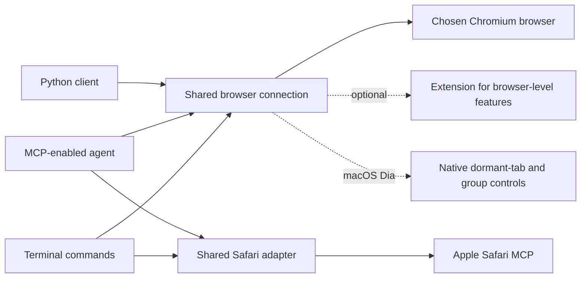

# browserctrl

[](https://github.com/seahyc/browserctrl/actions/workflows/test.yml)
[](LICENSE)

**browserctrl lets a coding agent work with a real browser you choose.** It can inspect a page, click buttons, fill forms, wait for a page to change, and read console or network errors. You can use it from a terminal, connect it to an agent that supports MCP, or install its agent skill when your agent supports skills.

## A note of thanks

browserctrl grew from [Petr Baudis's original `chrome-cdp-skill`](https://github.com/pasky/chrome-cdp-skill). Thank you, Petr, for creating and sharing the small, dependency-light tool that made this project possible. browserctrl keeps that browser-control foundation and adds a shared connection that its CLI, MCP server, and Python client can use together, along with optional coordination and browser features. The two projects have different scopes; browserctrl does not claim to be a performance improvement or a replacement for the original.

## Ask your coding agent to install it

Copy and paste this request into your coding agent:

> Please install browserctrl from https://github.com/seahyc/browserctrl. Read its instructions, check my operating system and Node.js version, and set up whichever interface my agent supports: CLI, MCP or an agent skill. Use a local checkout and tell me what you configured. Ask which browser I want to use, and get my permission before enabling browser access or restarting it. Verify setup on a disposable test page, then show me how to use and uninstall it.

For a manual CLI setup, install [Node.js 22 or newer](https://nodejs.org/), then run:

```sh
git clone https://github.com/seahyc/browserctrl.git
cd browserctrl
npm ci
node bin/browserctrl.mjs help
```

Run commands this way from the checkout with `node bin/browserctrl.mjs <command>`. If you want `browserctrl` available as a shell command everywhere, `npm link` adds it to your PATH (and also provides the compatibility names `cdp` and `browserctl`). That is an optional global setup step.

## Choose how to connect your agent

- **CLI:** A good default when your agent can run terminal commands. It does not require the agent to support skills or MCP. From the checkout, use `node bin/browserctrl.mjs`; after `npm link`, use `browserctrl`.
- **MCP:** Use this when your agent can connect to MCP servers. Point its MCP configuration to `node /absolute/path/to/browserctrl/mcp/server.mjs`, using the checkout's absolute path. The server uses dependencies installed by `npm ci` in that checkout.
- **Agent skill:** Use this only if your agent has a skill-installation mechanism. For agents that load skills from `~/.agents/skills`, link or clone this repository at `~/.agents/skills/browserctrl`, then invoke `$browserctrl`. Other agents may use a different skill format or may not support skills; follow that agent's instructions instead of assuming this path works everywhere.
- **Python client:** Python projects can use the persistent client in `python/chrome_cdp`. Add the repository's `python` directory to `PYTHONPATH` and import `ChromeCDP` from `chrome_cdp`. It starts a Node sidecar, so Node.js 22 or newer and the installed repository dependencies are still required. See [the Python helpers](python/chrome_cdp/HELPERS.md).

The Chromium interfaces use the same browser-control core. Safari uses Apple’s official MCP server through its own adapter; the Python CDP client is Chromium-only. Pick the one your agent already supports; you do not need to configure all of them.

## What using it looks like

First, list available browsers and choose one by name. browserctrl does not guess which browser you mean:

```sh
node bin/browserctrl.mjs browsers
node bin/browserctrl.mjs tabs --browser chrome
node bin/browserctrl.mjs open https://example.com --browser chrome
```

On macOS, Chrome may need remote debugging enabled for its existing profile. Open `chrome://inspect/#remote-debugging` in Chrome, enable the setting, then run `browsers` again. Recent Chrome versions may not accept debugging flags for an existing profile. To use a separate clean profile instead, you can launch Chrome with a dedicated debugging port and user-data directory:

```sh
"/Applications/Google Chrome.app/Contents/MacOS/Google Chrome" \
  --remote-debugging-port=9222 --user-data-dir=/tmp/browserctrl-chrome
```

For a custom debugging endpoint, use `--port <number>` instead of `--browser <name>`. Do not use a disposable test against a browser profile that contains data you need.

Read the page before taking action. The snapshot gives elements simple references such as `ref_2`; use those references to click or fill the intended element:

```sh
node bin/browserctrl.mjs read <tab-id> --browser chrome
node bin/browserctrl.mjs click <tab-id> --ref ref_2 --browser chrome
node bin/browserctrl.mjs fill <tab-id> --ref ref_3 --value "Example" --browser chrome
node bin/browserctrl.mjs wait <tab-id> --text "Saved" --browser chrome
```

Take a new snapshot after navigation or page changes. References are invalidated by navigation and by the next snapshot. If a command times out or the connection drops during an action, check the page before trying again: browserctrl does not replay actions whose result is uncertain.

## Recipes, profiles and captchas

**Recipes** call a site's own API from a tab on that site instead of driving its UI. A recipe is a small JSON file; it runs inside your logged-in tab, so the site's cookies and request signing apply, and it holds no credentials. For data tasks such as an order history this returns structured results in seconds where driving the page takes minutes. Shared recipes come from git repositories called taps, such as [browserctrl-recipes](https://github.com/seahyc/browserctrl-recipes):

```sh
node bin/browserctrl.mjs recipe tap add https://github.com/seahyc/browserctrl-recipes
node bin/browserctrl.mjs recipe find "shopee orders"
node bin/browserctrl.mjs recipe run shopee.sg/orders --browser chrome
```

`open`, `nav` and `read` print a `hint:` line when the page's site has a recipe. To write one, browserctrl records the fetch/XHR traffic of tabs it drives (`recipe endpoints <host>`, `recipe inspect <host>`; set `BROWSERCTRL_CAPTURE=0` to turn this off). Recipes use sites' internal APIs, which can change without notice; you are responsible for using them within each site's terms. The format is in [references/recipes.md](references/recipes.md).

**One lookup per site:** `browserctrl site <site|url>` (MCP `browser_site`) lists the site's recipes with their run command, then its flow notes with ids, the page's own first; the hint block on `open`, `nav`, `read` and `do` shows the top of both with counts.

**Flow notes:** short facts about how a site works, written by agents. After a task, the agent adds what would have saved it the most time (`notes add <site> "<fact>"`; `--api` for where a page's data comes from, a recipe candidate; `--recipe <name>` to point at a recipe), confirms notes that held and drops ones that were wrong (`notes confirm|drop <id>`). Before a note is stored, Jev is asked whether it is a reusable fact about the site rather than the task's answer, chosen values or personal data; notes that fail are rejected (`--force` overrides; without a Jev key they are kept and marked unchecked). One general rule also writes notes from `do` traces: a control that put a filter in the URL, with task values masked. `open`, `nav`, `read` and each `do` step that lands on a new kind of page print a site's best notes as `hint:` lines with their ids. Notes also act inside `do`: the current page's notes go to Jev as context with each step; a `--reveal "<target>" '<step>'…` note runs its steps when a step's target cannot be found, then retries (`via note <id>`); an `--on "<situation>" '<step>'…` note runs its steps when Jev sees the situation; a URL note covering a planned click is suggested. Notes that ran are confirmed or contradicted automatically. Each note keeps a count and dates; a contradicted one is dropped and unused ones expire after 90 days. `www.` and two-level suffixes share one site (`gov.uk` = `www.gov.uk`). `notes [site] [--clear]` shows or clears them; `BROWSERCTRL_NOTES=quiet` records without hinting and `=off` disables them. They stay local in `~/.local/share/browserctrl/notes/`.

**Profiles:** `profiles --browser chrome` lists a Chromium browser's profiles, `tabs --profile <name>` shows one profile's tabs, and `open <url> --profile <name>` opens a tab in that profile, opening a window for it if needed. `--profile` accepts the profile directory, account email, display name or a unique prefix.

**Captchas:** `captcha <tab>` makes one attempt at a plain drag-to-the-end slider. For any other challenge, or if that attempt fails, it shows a desktop notification on macOS and waits for you to clear the challenge.

**Run recordings:** `rec start <tab>` / `rec stop <tab>` keep one tab's run for watching later in little space: rrweb DOM events (brotli) plus one small JPEG still per action, across navigations. `replay <dir>` builds one self-contained HTML with a DOM replay and a clickable step timeline. `rec om2w` writes the run as an Online-Mind2Web `result.json` for its WebJudge. A 13-step run is about 0.7 MB. rrweb 2.1.7 is vendored in `vendor/rrweb/` (MIT).

## How this differs from the original

[Petr Baudis's chrome-cdp-skill](https://github.com/pasky/chrome-cdp-skill) is the foundation. It is a smaller, dependency-light way to control Chromium, with Windows, Linux and macOS support. Choose it if its focused CLI does what you need.

browserctrl adds a connection shared by multiple agents, tab claims to reduce interference, an MCP server, a persistent Python client, optional tab organization and human handoffs, and Safari support through Apple's interface. These additions also bring more code and dependencies. We have not measured an equivalent speed or reliability comparison, so we do not claim a percentage improvement. Windows profile discovery and pipe transport follow upstream's approach; our locking and shared daemon are additional work. Safari control is supplied by Apple and WebKit. Thank you to both upstream teams and everyone who shares improvements.

## Sharing a browser safely

The CLI, MCP server, and Python client share a long-lived connection for each browser debugging port. This lets browser events such as console messages and network errors remain available across commands. Agents using browserctrl can also claim a tab while working on it; claims expire after 15 minutes unless renewed. Claims help coordinate agents that use browserctrl, but they do not hide or isolate your browser data and cannot control other tools.

browserctrl supports Chromium browsers on macOS, Linux and Windows. It recognizes Chrome, Dia, Brave, Edge, Chromium and Arc where installed. Dia also has optional native controls for dormant tabs (tabs not shown in its ordinary tab list) and tab groups. An optional browser extension enables tab groups and other browser-level features that the page-control protocol does not provide; ordinary page control does not require the extension. Loading the extension and granting its requested permissions is a separate setup step.

Platform-specific details and test evidence are in [compatibility](docs/compatibility.md). Windows uses named pipes and a PowerShell lock adapter; it does not require AppleScript. An optional screenshot setting emulates page focus without activating a window. It does not guarantee background capture: Windows CI screenshots required selecting the owned test tab. Automatic browser relaunch, screen video, and Dia's native dormant-tab controls remain macOS-only.

### Safari

Safari 27 or later on macOS has its own official automation interface. Enable Safari Settings → Advanced → Show features for web developers, then Settings → Developer → Allow remote automation and external agents. Safari may ask you to authenticate. browserctrl does not enable this permission for you.

```sh
node bin/browserctrl.mjs safari tools --browser safari
node bin/browserctrl.mjs open https://example.com --browser safari
node bin/browserctrl.mjs read <full-tab-handle> --browser safari
```

Safari returns its own element IDs, called node UIDs, instead of Chromium's `ref_2` references. The CLI supports common page operations; the `browser_safari` MCP tool also exposes Apple's native tools and batch interactions. A shared Safari connection serializes tab selection and actions, and checks tab ownership before touching a tab. This adds coordination around Apple's tools, rather than replacing the browser engine.

Safari automation uses a separate session. Do not assume it shares your normal Safari tabs, logins or history. Chromium tab groups, dormant Dia tabs, raw CDP, Python CDP calls and recording are not supported by the Safari adapter. Background input depends on Safari itself; browserctrl cannot remove Apple's focus or automation-window restrictions. For one agent that only needs Safari, [Apple's default MCP](https://webkit.org/blog/18136/introducing-the-safari-mcp-server-for-web-developers/) may be all you need.

## How browserctrl is organized



For complete command usage, run `node bin/browserctrl.mjs help` (or `browserctrl help` after `npm link`). See [compatibility details](docs/compatibility.md), [contributing](CONTRIBUTING.md), and [security reporting](SECURITY.md).

## License

browserctrl and the upstream project are MIT-licensed. See [LICENSE](LICENSE) for the retained copyright and license notices.

## Know what each agent is doing

Agents can describe their task and progress. `browserctrl activity --browser dia` shows who owns which tabs, what they are doing, and warnings about rapid navigation or tab selection. To pause a browser task, use `browserctrl activity pause --owner AGENT_ID --browser dia`; use `resume` to let it continue. A pause preserves tabs and ownership, and does not undo an action already sent. These controls also work through MCP and the Safari adapter.

`browserctrl ready TAB_ID --browser dia` checks whether a page has loaded without selecting or reloading it. `browserctrl focus TAB_ID --browser dia` selects the tab without reloading it. `browserctrl reload TAB_ID --browser dia` reloads the current page without selecting the tab and waits for the new document to load. `wake` remains an alias for `focus`, and `refresh` is an alias for `reload`. See [agent activity](references/activity.md) for readiness, reload wait options and task controls. Safari reload uses the same CLI helper within its separate automation session. Safari focus selects that session's automation context and does not guarantee foregrounding a normal Safari window.
