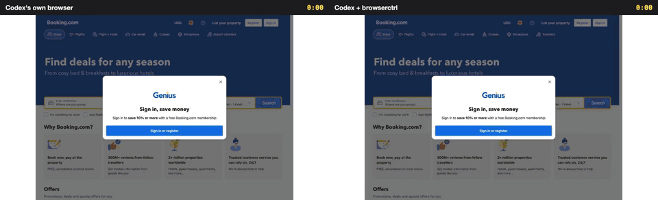
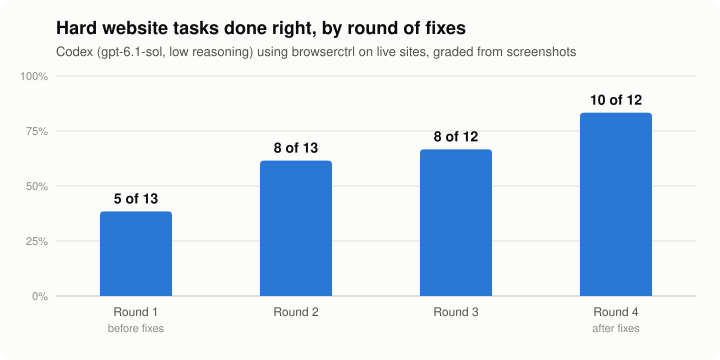
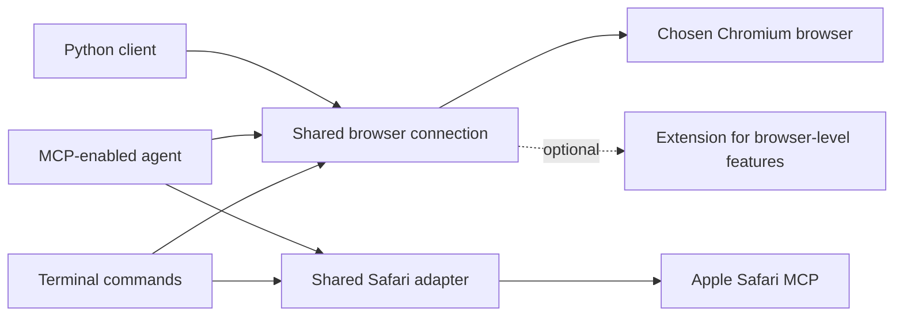

# browserctrl

[](https://github.com/seahyc/browserctrl/actions/workflows/test.yml)
[](LICENSE)

**browserctrl lets an AI use websites for you, including the fiddly ones with calendars, tiny checkboxes and fine print, with fewer mistakes, and often faster.**



*The same AI on the same hard task, on its first try. Left: Codex using its own built-in browser. Right: the same Codex using browserctrl. Shown 4× faster; [watch it in real time](docs/media/booking-side-by-side.mp4).*

The task: *"Find the cheapest hotel + flight + car package from New York to San Francisco, departing tomorrow and returning on the fourth day, for two adults and a six-year-old child, one room with free breakfast and spa access."*

| | Codex's own browser | Codex + browserctrl |
| --- | --- | --- |
| Got it right | ✅ | ✅ |
| Time | 5 min 3 s | **3 min 10 s** |
| Actions | 33 | **18** |
| Text the AI had to read (tokens) | 3.7 million | **1.1 million** |

It doesn't always win. In the first of two Airbnb runs, Codex's own browser was faster; [the results section](#does-it-really-work) shows both runs and what we changed in between.

## What it does, in plain words

Think of browserctrl as a better pair of hands for an AI that uses the web.

- **It does several steps in one go.** Instead of looking at the whole page before every click, the AI writes a short plan: *type "Cleveland", pick 17 to 20 October, add a pet, tick "Free parking"*. browserctrl carries it out and only stops if something looks wrong. A small, fast model called Jev works out which button each step means, in about a third of a second.
- **It handles the fiddly parts.** Calendars, plus and minus buttons, small checkboxes, menus that only appear when clicked, and pop-ups that get in the way.
- **It checks its own work.** If a box didn't tick, or the page shows an error, it stops and says so rather than carrying on as if it worked. When it isn't sure it picked the right button, it says that too.
- **It never pays for you.** It won't press Buy, Pay, Book or Send unless it is told to in so many words.
- **It skips the clicking when it can.** For sites it knows, a *recipe* asks the site for the information directly. Your whole Shopee order history comes back in about 7 seconds instead of minutes of scrolling.
- **It keeps a small recording of every run.** About 1 MB per run, which you can watch later as a video, like the one above.
- **It asks you about captchas** instead of fighting them, and hands the tab back once you've solved it.

## Does it really work?

<picture>
  <source media="(prefers-color-scheme: dark)" srcset="docs/media/rounds-dark.svg">
  
</picture>

We took 13 hard tasks from [Online-Mind2Web](https://github.com/OSU-NLP-Group/Online-Mind2Web), a public test of AI agents on real, live websites: ordering food for pickup, booking packages, filtering rentals, finding a garage that fits a pickup truck. These are the tasks that most published agents (OpenAI Operator, Claude Computer Use, Browser Use and others) got wrong. We ran each one, watched where browserctrl got in the way, fixed that, and ran them all again. After four rounds, 10 of the 12 tasks were done right, up from 5 of 13.

How we kept it honest:

- **One try per task per round**, by Codex (`gpt-6.1-sol` at low reasoning), on the live sites, through a US internet connection on New York time, since the tasks assume a US visitor.
- **Graded from screenshots** by a port of the benchmark's own judge, which saw the task, the AI's actions and the final pages. The AI is never allowed to actually buy, book or send; stopping at the last step counts.
- **Two grading mistakes were fixed and rescored**: the judge didn't know the date (so "the day after tomorrow" looked wrong), and it failed a run for not completing a purchase the rules forbid.
- **What still fails:** Best Buy throttles automated browsers (its trade-in page never loads), and Raising Cane's answered "temporarily unavailable" in the last round. We dropped one gov.uk task from round 3 on, because it requires an answer the task never gives.

**Against Codex's own browser** (same model, same browser, same recording, no recipes, first try):

| Task | Codex's own browser | Codex + browserctrl |
| --- | --- | --- |
| Booking.com package, New York to San Francisco | ✅ 5:03, 33 actions, 3.7M tokens | ✅ **3:10, 18 actions, 1.1M tokens** |
| StubHub: NHL games in Boston | ✅ 2:12, 12 actions, 0.69M tokens | ✅ **1:56, 11 actions, 0.60M tokens** |
| Airbnb: Cleveland, 3 nights, kids, a pet, parking, washer, gym (first run) | ✅ **2:21, 17 actions, 0.98M tokens** | ✅ 3:43, 26 actions, 1.75M tokens |
| The same Airbnb task, after the fixes below (second run) | ❌ ran out of time at 15:00, 33 actions | ✅ **2:40, 17 actions, 1.04M tokens** |

The StubHub browserctrl run comes from the notes test (with notes off), on the same connection and time zone but in branded Chrome rather than Chrome for Testing, which Codex's own browser needs for its extension.

browserctrl lost the first Airbnb run, and the recording showed why. Its clicks scrolled the page a little even when a button was already on screen, and Airbnb hides its search bar whenever the page scrolls; a "Gym" button under the filters' footer couldn't be found; a notice covering "Filters" went unmentioned; and Airbnb's on/off buttons weren't tracked. After fixing those, the same task needs two `do` plans instead of about twenty steps. In the second run browserctrl finished in 2:40, while Codex's own browser ran out of its 15 minutes. Two runs are not many: Codex's own browser took 2:21 the first time and 15 minutes the second, so treat these as examples rather than averages. [Watch the first Airbnb run side by side](docs/media/airbnb-side-by-side.mp4).

**On sites it had never seen.** The fixes above were made while watching those 13 tasks, so they could be tuned to those sites. To check, we keep held-out tasks on other sites, chosen before each round of fixes, and run both methods on them once. Each held-out set is studied afterwards and retired, so the next one is fresh.

| Held-out round | Codex's own browser | Codex + browserctrl |
| --- | --- | --- |
| Round 1: 10 hard tasks, US VPN | 6 of 10, **27.5 min** | **8 of 10**, 31.1 min |
| Round 2: 11 hard tasks, US VPN | 3 of 9 | 3 of 10 |
| Round 3: 9 hard tasks, direct connection | **7 of 8** | 6 of 8 |
| Round 3, the 6 tasks both reached | 6 of 6, 13.1 min | 6 of 6, **11.5 min** |

What we learned from these:

- **Some of browserctrl's early slowness was our test setup.** Round 1's browserctrl runs carried about 115 characters of settings on every command and waited on their own recording screenshots; Codex's own browser did neither. Fixing that, and making both methods identical in every way but the tool, is what made round 3 a fair comparison.
- **Many failures were the websites, not the tools.** In round 2 about a third of the runs never got past a Cloudflare check through the VPN, so from round 3 on we use only sites that load directly. A few task pages still turned out to be blocked or region-locked (Healthgrades, SourceForge).
- **The automatic judge makes mistakes.** In round 2 it failed at least three runs whose screenshots show the right answer. For held-out rounds we now use the benchmark's full multi-screenshot judge and check disputed verdicts by hand.
- **On unseen sites the two methods are close.** browserctrl gets about as many tasks right as Codex's own browser and, on the tasks both reached in round 3, was a little faster. The big wins in the head-to-head above were on sites browserctrl had been fixed on.

The final 21 tasks, which we will report as the unseen-site result, haven't been run yet; the split is in [bench/om2w/splits.json](bench/om2w/splits.json), made by [split.py](bench/om2w/split.py), and the sites reachable without a VPN are in [access.json](bench/om2w/access.json).

**Notes did not help yet.** browserctrl can keep notes about how each site works and show them to the next AI that visits. On 8 new tasks on sites it had already explored, runs with notes passed 7 and runs without passed 8, in about the same time. The new tasks mostly used parts of each site the notes didn't cover.

Every run, with its task, method, verdict, time, actions and tokens, is in [docs/results/om2w-2026-10.runs.md](docs/results/om2w-2026-10.runs.md). The harness that ran them is [bench/om2w](bench/om2w/README.md).

## Try it

Copy and paste this into your coding agent:

> Please install browserctrl from https://github.com/seahyc/browserctrl. Read its instructions, check my operating system and Node.js version, and set up whichever interface my agent supports: CLI, MCP or an agent skill. Use a local checkout and tell me what you configured. Ask which browser I want to use, and get my permission before enabling browser access or restarting it. Verify setup on a disposable test page, then show me how to use and uninstall it.

To set it up yourself, install [Node.js 22 or newer](https://nodejs.org/), then:

```sh
git clone https://github.com/seahyc/browserctrl.git
cd browserctrl
npm ci
node bin/browserctrl.mjs help
```

`npm link` makes `browserctrl` available everywhere (plus the older names `cdp` and `browserctl`).

## For developers

### Connecting your agent

- **CLI:** the default when your agent can run terminal commands; it needs no skill or MCP support.
- **MCP:** point your agent's MCP configuration at `node /absolute/path/to/browserctrl/mcp/server.mjs`.
- **Agent skill:** for agents that load skills from `~/.agents/skills`, link or clone this repository at `~/.agents/skills/browserctrl`. [SKILL.md](SKILL.md) is the full guide agents read.
- **Python:** `python/chrome_cdp` has a persistent client that starts a Node sidecar. See [the Python helpers](python/chrome_cdp/HELPERS.md).

All Chromium interfaces share one browser-control core. Safari uses Apple's official MCP server through its own adapter.

### The basics

Pick a browser by name; browserctrl never guesses:

```sh
browserctrl browsers
browserctrl open https://example.com --browser chrome
browserctrl read <tab> --browser chrome            # the page, with refs like ref_2
browserctrl click <tab> ref_2 --browser chrome
browserctrl fill <tab> ref_3 "Example" --browser chrome
```

On macOS, enable Chrome's remote debugging at `chrome://inspect/#remote-debugging`, or launch a separate profile with `--remote-debugging-port=9222 --user-data-dir=/tmp/browserctrl-chrome` and use `--port 9222`. `read` waits for a loading page and says how long it waited. A ref keeps meaning what your last `read` showed; if the page changed, browserctrl says the ref is stale instead of clicking something else. It never replays an action whose result is uncertain, and a stuck page can be recovered with `reload`.

### Plans with `do`

```sh
browserctrl do <tab> 'fill "Where" = "Cleveland"' 'key Enter' 'date 2026-10-17' 'date 2026-10-20' \
  'click "Increase Pets"' 'click "Search"' --then items --browser chrome
```

Each step names an element in words (or by ref or CSS selector). `do` matches exact names itself and asks Jev for the rest, waits for each result, and stops at the first step it can't do with confidence: a missing element, an unsure pick (marked ⚠), a checkbox that didn't change, an error on the page, or anything that would commit a purchase (`click!` marks a step you mean to commit). `date YYYY-MM-DD` picks a day in any calendar. `=> "<expected>"` checks a result, `--dismiss` closes cookie banners, and `--repeat … --until …` pages through lists.

### Recipes, notes, profiles and captchas

**Recipes** call a site's own API from a tab on that site instead of driving its UI. A recipe is a small JSON file that runs inside your logged-in tab, so it holds no credentials. Shared recipes come from git repositories called taps, such as [browserctrl-recipes](https://github.com/seahyc/browserctrl-recipes):

```sh
browserctrl recipe tap add https://github.com/seahyc/browserctrl-recipes
browserctrl site shopee.sg                         # the site's recipes and notes in one lookup
browserctrl recipe run shopee.sg/orders --browser chrome
```

Recipes use sites' internal APIs, which can change without notice; you are responsible for using them within each site's terms. The format is in [references/recipes.md](references/recipes.md).

**Notes** are short facts about how a site works, written by agents after a task (`notes add <site> "<fact>"`) and checked by Jev so a note can't carry the task's answer or personal data. They are shown as hints, passed to Jev as context in `do`, and can carry runnable steps: `--reveal "<target>" '<step>'` runs when a target is hidden, `--on "<situation>" '<step>'` when a situation appears. Notes that run are confirmed or contradicted automatically, and unused ones expire after 90 days. They stay local in `~/.local/share/browserctrl/notes/`; `BROWSERCTRL_NOTES=quiet` records without hinting and `=off` disables them.

**Profiles:** `profiles --browser chrome` lists a Chromium browser's profiles; `open <url> --profile <name>` opens a tab in one.

**Captchas:** `captcha <tab>` tries a plain drag-to-the-end slider once, otherwise notifies you and waits until you clear the challenge.

### Recordings and videos

```sh
browserctrl rec start <tab> --browser chrome       # rrweb DOM events + one still per action
browserctrl rec stop <tab> --browser chrome
browserctrl replay <dir>                           # an HTML replay with a clickable step timeline
browserctrl replay <dir> --video run.mp4 --gif run.gif
browserctrl replay --side-by-side <a> <b> --labels "Before,After" --video ab.mp4 --gif ab.gif
```

A recording is the page's DOM changes (brotli) plus a small JPEG per action, about 1 MB for a 3-minute run. Videos replay it at the real speed with plain-words captions and a clock; the side-by-side above was made this way. `rec om2w` exports a run for the Online-Mind2Web judge. rrweb 2.1.7 is vendored in `vendor/rrweb/` (MIT).

### Sharing a browser safely

The CLI, MCP server and Python client share one long-lived connection per browser debugging port, so console messages and network errors stay available across commands. Agents claim a tab while they work on it; claims expire after 15 minutes unless renewed. Claims coordinate agents that use browserctrl, but they don't hide your browser data or control other tools. `browserctrl activity --browser chrome` shows who owns which tab and what they're doing, and `activity pause --owner <id>` pauses an agent.

browserctrl supports Chromium browsers (Chrome, Dia, Brave, Edge, Chromium, Arc) on macOS, Linux and Windows. An optional extension adds tab groups and other browser-level features; Dia also has native controls for dormant tabs. Details and test evidence are in [compatibility](docs/compatibility.md).

**Safari** 27 or later on macOS works through Apple's own automation interface, in a separate automation session with its own element IDs. Enable Settings → Advanced → Show features for web developers, then Settings → Developer → Allow remote automation and external agents. browserctrl does not enable this for you.



Full command usage: `browserctrl help`. See also [contributing](CONTRIBUTING.md) and [security reporting](SECURITY.md).

## Thanks

browserctrl grew from [Petr Baudis's `chrome-cdp-skill`](https://github.com/pasky/chrome-cdp-skill), a small, dependency-light way to control Chromium. Thank you, Petr, for creating and sharing it. If its focused CLI does what you need, choose it: browserctrl adds a shared connection, an MCP server, a Python client, `do` plans with Jev, recipes, recordings and Safari support, and with them more code and dependencies.

## License

MIT, like the upstream project. See [LICENSE](LICENSE).
