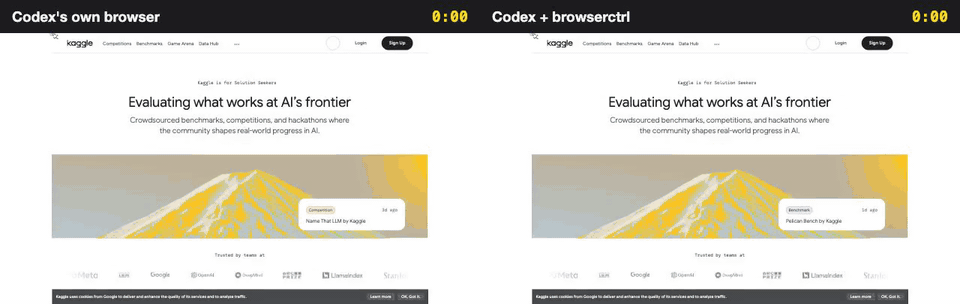
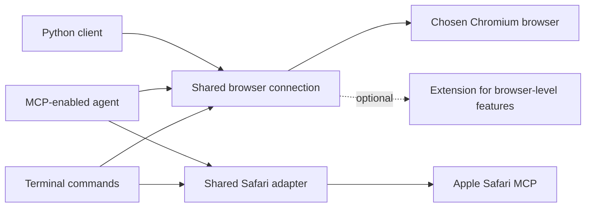

# browserctrl

[](https://github.com/seahyc/browserctrl/actions/workflows/test.yml)
[](LICENSE)

browserctrl gives an AI agent a better pair of hands for websites. It's meant for the annoying sites: filters that hide inside drawers, calendars, sliders, little checkboxes, and fine print you only see after three clicks.

I tested it the only way I trust: same AI, same task, same browser, once with Codex's own built-in browser and once with browserctrl. Here's Kaggle, a site browserctrl had never been tuned on. The task was "find the ongoing competition with the highest prize, and the code that got the most votes in it". Codex's own browser is on the left and took 3 min 25 s. Codex with browserctrl is on the right and took 1 min 40 s.



The GIF runs at 4x. Here's the real-time version:

https://github.com/user-attachments/assets/70861a56-af97-4f83-a000-733364cf41c8

Over 21 hard tasks on 17 sites it had never seen, it got as many right as Codex's own browser, and was faster on most of them:

| 21 hard tasks, 17 unseen sites | Codex's own browser | Codex + browserctrl |
| --- | --- | --- |
| Tasks done right (checked by hand) | 17 | 18 |
| Total time on the 15 tasks both got right | 45.8 min | 40.0 min |
| Median task | 2 min 48 s | 2 min 20 s |
| Faster on | 6 of 15 | 9 of 15 |
| Tokens read | 17.7 million | 11.9 million |

Both sides used the same model (`gpt-6.1-sol` at low reasoning), the same browser and the same machine, one try each. It's a small sample, and below I go through [how I kept it fair](#keeping-it-fair), [the runs it lost](#the-runs-it-lost) and [every single run](docs/results/om2w-2026-10.runs.md).

## What it does

The AI writes a short plan, like *open Filter, pick size M, pick Black, show the results*, and browserctrl carries out all of it in one go. Codex's own browser does one click per turn, and each turn means reading the page again and thinking for a few seconds. Most of the time saved comes from that.

After the plan runs, browserctrl tells the AI what changed: "Results: 51 items → 3 items", "Black: now ticked". So the AI can answer without reading the whole page again.

It checks its own work. If a box didn't tick, a section didn't open or the page shows an error, it stops there and says so, instead of carrying on three steps later as if all was fine. When it's unsure it picked the right button, it says that too.

It won't press buttons that look like they spend money or send something (Buy, Pay, Book, Send, Place order, Delete, and so on) unless the plan marks that step on purpose. To be clear about how that works: it's a fixed list of English words plus a check for card fields and order totals on the page. It doesn't use a model. So it can miss a "Comprar" button, and it sometimes blocks a harmless "Submit" on a quiz.

For sites it already knows, a *recipe* skips the clicking and asks the site's own API. A whole Shopee order history comes back in about 7 seconds that way.

It doesn't record anything by default. You can ask it to record a run (about 1 MB for 3 minutes) and replay it as a video, which is how every clip on this page was made.

## More runs, on very different sites

I picked these to cover different kinds of sites, including two where browserctrl lost. Each one is a real benchmark run, with Codex's own browser on the left and browserctrl on the right, on one shared clock.

**League of Legends.** "Browse the final skin in the list for the champion Ahri." Own browser 3:37, browserctrl 1:19.

https://github.com/user-attachments/assets/b28a8d84-e813-442c-87cb-9209667f333b

**WebMD.** "Find the best audiologist within 50 miles of New York, NY, with a rating of 4 and above." Own browser 2:48, browserctrl 1:02.

https://github.com/user-attachments/assets/fa1307c9-629a-4014-af04-d7dbed5b544c

**Stanford.** "Browse the class schedule of graduate-level chemistry courses on Monday afternoons in the winter of 2023." Own browser 3:28, browserctrl 2:01.

https://github.com/user-attachments/assets/73186adb-e3a8-47e8-a18a-f556ba7cb77c

**Google Maps.** "Find the top-rated hotel in Manhattan, NY, suitable for 4 guests, and identify the fastest public transportation option from the hotel to LGA airport." Own browser 5:55, browserctrl 3:42.

https://github.com/user-attachments/assets/25f5ab22-843c-416f-87d9-dd20de49f012

### The runs it lost

**Chase.** "How much can I have in my 401(k) at retirement, working from 22 to 65, at 3% a year, with $8,000 from me and $8,000 from my employer every year?" Own browser 2:24, browserctrl 4:50.

https://github.com/user-attachments/assets/bc828ad1-e2c2-4036-98bd-55536c81ea8c

The calculator is five sliders drawn inside web components, and browserctrl's slider command couldn't see inside those, so the AI ended up pressing arrow keys one at a time. I fixed that afterwards. The same five settings now take 4 seconds in one call.

**FlightAware.** "Find United or American flights from London to New York that arrive between 8 and 11 PM." Own browser 2:32, browserctrl 5:05.

https://github.com/user-attachments/assets/30d9cb17-2ec4-48e5-86cf-e2266789ef1c

The airport boxes suggest matches as you type, and the AI spent several plans getting London and New York to stick. Then it struggled with the airline and arrival-time filters, until it typed the filtered web address directly.

Two more browserctrl runs ran out of their 15 minutes: Statista, on a greyed-out Apply button, and Steam, on a playtime slider that the `set` command couldn't reach. Steam's is fixed now and takes one step. arXiv also answered "Rate exceeded" to one run.

Codex's own browser lost the same Statista task, plus three more to its own safety rules. It refused to open BabyCenter at all, twice, and it refused to press "I agree" on YouTube Kids.

## Where Jev comes in

browserctrl uses two models. The AI agent, Codex in these tests, plans, reads results and decides when the task is done. Jev is a small, fast model that answers one narrow question: given a page and a list of its controls, which control does this step mean? It answers in about a third of a second.

<picture>
  <source media="(prefers-color-scheme: dark)" srcset="docs/media/how-jev-fits-dark.svg">
  
</picture>

Jev gets a few lines of text, with no screenshot. Below is the exact input from one real step: the agent wrote `click "Sort by"` on Google Maps, and Jev got the page's address, title, visible text and its 57 clickable controls by role and name. It put 99% on the right button, in 340 ms.


Here's what that looks like while it runs. browserctrl can draw on the page as it works: every control Jev was offered gets a numbered box, its pick gets a red outline, and a panel in the corner logs each step. Steps the agent named exactly say "exact name match, no model call". Steps that needed Jev show its top choices and how sure it was.

https://github.com/user-attachments/assets/82e2933e-6bf1-4075-8feb-f63d0505dcb5

On Uniqlo, one plan picked men's blazers, size M, in black. Five of its seven steps named a control exactly and needed no model. Jev picked "Filter" (the button is actually called "Filter 1") at 94%, and "View results" (the button says "VIEW ITEMS (3)") at 97%. The report ended with "Results: 51 items → 3 items" and the new heading "Men's Blazers (M, BLACK)", which was everything the agent needed.

https://github.com/user-attachments/assets/0408b1b8-78c3-4b4b-920c-12a7aefb2b4f

Across 95 browserctrl runs in this benchmark, agents wrote 926 plans. About 3 steps in 4 named a control exactly and went straight through. About 1 in 4 needed Jev, for names an agent can't know in advance: "Filter 1", "VIEW ITEMS (3)", or a YouTube Kids age card whose real name is "Younger. Ages 5 to 8. Hit Enter to select." Jev's typical confidence was 98%. About 1 pick in 9 came in under 75%, and browserctrl still acts on those but marks them ⚠ so the agent checks. When nothing fits, it stops and lists the closest controls instead of guessing.

Exact matches are cheaper than asking Jev, so I try to make more of them. Google's "Sort by" button is really named "Sort by" plus an icon character, and that one invisible character sent the step to Jev. browserctrl now ignores icon characters, so that step needs no model at all.

### Why not let Jev drive?

That was the first thing I tried. In an earlier benchmark I gave Jev whole tasks, like filtering a search, opening a chat or adding an item to a cart, and let the agent finish whatever Jev left. Over 21 runs on 7 tasks, Jev finished none of them. It would make 1 to 7 moves and then stop at the first control outside what it was allowed to do: a sort menu, a filter, a chat button, even an "Add to cart" it had been given permission for. On pages that change as you use them it looped, retrying 30 times on one Shopee search without acting. And it doesn't read, while most of an agent's time goes into reading results and checking the answer. So the agent read everything anyway, and Jev was never 30% faster on any task, which was the bar I set before running.

Then I flipped it around. The agent plans and reads, and Jev only picks the control each step means, inside browserctrl. Under the same rule, that won 5 of the same 7 tasks. Each win was a chain of clicks and fills that used to cost the agent one turn per step, and the 2 ties were tasks that are mostly reading one list. In a later round on 6 new sites, plans were never less accurate. They lost where the page has a web address the agent can guess, like a Hacker News item or a Stack Overflow tag, because going straight there beats any clicking. The details are in [bench/RESULTS.md](bench/RESULTS.md).

My takeaway: a small fast model is very good at a narrow question where every possible answer is listed, like "which of these 57 controls is 'Sort by'?". It's poor at open questions like "what should happen next, and are we done?". So each model gets the question it's good at.

## Keeping it fair

The tasks come from [Online-Mind2Web](https://github.com/OSU-NLP-Group/Online-Mind2Web), a public test of AI agents on real, live websites. I used only its hard tasks, the ones most published agents (OpenAI Operator, Claude Computer Use, Browser Use and others) get wrong.

I split the tasks by website with a fixed random seed into sites I could study and fix against, and sites I couldn't ([splits.json](bench/om2w/splits.json), [split.py](bench/om2w/split.py)). The 21 final tasks came from the second group and were run once. Every fix on this page that mentions those sites was made after that run.

The only difference between the two sides was the tool. Same model and settings, same browser (Chrome for Testing on New York time), same machine, cookies cleared before each run, and the same screenshots recorded for both. This took me a while to get right. In early rounds browserctrl carried extra settings on every command and waited on its own screenshots, and it looked slower than it was.

I also used only websites that load directly from Singapore. Through a VPN, about a third of runs never got past a Cloudflare check ([access.json](bench/om2w/access.json)).

The benchmark's automatic judge grades from screenshots, and it made a lot of mistakes. On the final set it passed 11 browserctrl runs and 10 native runs, and failed 14 runs whose own logs show the task was done. Usually the screenshot had caught a page still loading. Once, it passed one side and failed the other on the same evidence. It never passed a run that was wrong. So I re-checked all 42 runs against their logs ([handcheck.json](bench/om2w/handcheck.json)). Three of my calls are debatable: both WebMD runs read "best" as best-rated, and one arXiv run skipped a sort the judge wanted. Counting those three as failures makes it 17 to 15.

Two problems outside the methods got their runs redone, and I marked them. Codex's own browser tool stopped responding for about 20 minutes, so three of its runs were redone. I redid one browserctrl run because a test I ran on the same machine restarted its background process mid-run. Both versions of each are in [the run list](docs/results/om2w-2026-10.runs.md).

## Earlier rounds

Before the final set, I took 13 hard tasks and ran them in rounds. Each time, I watched where browserctrl got in the way, fixed that, and ran them all again. Tasks done right went from 5 of 13 to 10 of 12. These are the sites the fixes were made on, so treat them as a picture of what fixing can do on familiar sites.

<picture>
  <source media="(prefers-color-scheme: dark)" srcset="docs/media/rounds-dark.svg">
  
</picture>

On those same sites, against Codex's own browser:

| Task | Codex's own browser | Codex + browserctrl |
| --- | --- | --- |
| Booking.com package, New York to San Francisco | 5:03, 33 actions, 3.7M tokens | 3:10, 18 actions, 1.1M tokens |
| StubHub: NHL games in Boston | 2:12, 12 actions, 0.69M tokens | 1:56, 11 actions, 0.60M tokens |
| Airbnb: Cleveland, 3 nights, kids, a pet, parking, washer, gym | 2:21, 17 actions | 3:43, 26 actions |
| The same Airbnb task after fixes | ran out of its 15 minutes | 2:40, 17 actions |

The Booking.com run:

https://github.com/user-attachments/assets/190fc67c-091e-4f97-8c12-f7faa57471b2

And the first Airbnb run, where browserctrl lost. Its clicks scrolled the page a little, and Airbnb hides its search bar whenever the page scrolls.

https://github.com/user-attachments/assets/1174ef3f-8828-4e18-99eb-deca607e8144

Three held-out rounds on fresh sites came before the final set, and I studied and retired each one. That's where most of the lessons on this page came from: my test setup was slowing browserctrl down, many failures were websites blocking automated browsers, and the automatic judge makes mistakes. Once the setup was fixed, round 3 already showed the two sides close on accuracy, with browserctrl a little faster (6 of 6 tasks in 11.5 minutes, against 6 of 6 in 13.1).

I also tried letting browserctrl keep notes about how each site works, for the next AI that visits. It didn't help yet. On 8 new tasks on sites it had explored, runs with notes passed 7 and runs without passed 8, in about the same time. The new tasks mostly used parts of each site the notes didn't cover.

## Things I learned the hard way

Graders need the run's own evidence. A third of the final runs were graded wrong from screenshots alone, and a run's own log of what it set and what the page said back settled almost every dispute in seconds.

Codex's built-in browser has rules of its own. It refused BabyCenter outright and refused a consent button on YouTube Kids. A tool that drives an ordinary browser doesn't hit those walls, which also means more of the responsibility sits with you.

Small mismatches cost minutes. An icon character in a button's name, a sticky bar covering the first of three "Blazers" tabs, sliders hidden inside components, a filter panel that closes when the mouse leaves it. Each one turned a one-step action into several agent turns, and each fix was a few lines.

Most of the time goes to the agent thinking. Across the final set, browserctrl's `do` plans took under a fifth of its total run time. What actually speeds a run up is fewer and smaller turns: a whole plan in one call, and a short "what changed" report instead of a full page read.

## Try it

Copy and paste this into your coding agent:

> Please install browserctrl from https://github.com/seahyc/browserctrl. Read its instructions, check my operating system and Node.js version, and set up whichever interface my agent supports: CLI, MCP or an agent skill. Use a local checkout and tell me what you configured. Ask which browser I want to use, and get my permission before enabling browser access or restarting it. Verify setup on a disposable test page, then show me how to use and uninstall it.

To set it up yourself, install [Node.js 22 or newer](https://nodejs.org/), then:

```sh
git clone https://github.com/seahyc/browserctrl.git
cd browserctrl
npm ci
node bin/browserctrl.mjs help
```

`npm link` makes `browserctrl` available everywhere (plus the older names `cdp` and `browserctl`).

## For developers

### Connecting your agent

- **CLI:** the default when your agent can run terminal commands; it needs no skill or MCP support.
- **MCP:** point your agent's MCP configuration at `node /absolute/path/to/browserctrl/mcp/server.mjs`.
- **Agent skill:** for agents that load skills from `~/.agents/skills`, link or clone this repository at `~/.agents/skills/browserctrl`. [SKILL.md](SKILL.md) is the full guide agents read.
- **Python:** `python/chrome_cdp` has a persistent client that starts a Node sidecar. See [the Python helpers](python/chrome_cdp/HELPERS.md).

All Chromium interfaces share one browser-control core. Safari uses Apple's official MCP server through its own adapter.

### The basics

Pick a browser by name; browserctrl never guesses:

```sh
browserctrl browsers
browserctrl open https://example.com --browser chrome
browserctrl read <tab> --browser chrome            # the page, with refs like ref_2
browserctrl click <tab> ref_2 --browser chrome
browserctrl fill <tab> ref_3 "Example" --browser chrome
```

On macOS, enable Chrome's remote debugging at `chrome://inspect/#remote-debugging`, or launch a separate profile with `--remote-debugging-port=9222 --user-data-dir=/tmp/browserctrl-chrome` and use `--port 9222`. `read` waits for a loading page and says how long it waited. A ref keeps meaning what your last `read` showed; if the page changed, browserctrl says the ref is stale instead of clicking something else. It never replays an action whose result is uncertain, and a stuck page can be recovered with `reload`.

### Plans with `do`, and finding things

```sh
browserctrl do <tab> 'fill "Where" = "Cleveland"' 'key Enter' 'date 2026-10-17' 'date 2026-10-20' \
  'click "Increase Pets"' 'click "Search"' --then items --browser chrome
```

Each step names an element in words (or by ref or CSS selector). `do` matches exact names itself and asks Jev for the rest, waits for each result, and stops at the first step it can't do with confidence: a missing element, an unsure pick (marked ⚠), a checkbox that didn't change, an error on the page, or anything that would commit a purchase (`click!` marks a step you mean to commit). `date YYYY-MM-DD` picks a day in any calendar, and `set "<slider>" = 30-65` moves sliders, including ones inside web components. `=> "<expected>"` checks a result, `--dismiss` closes cookie banners, and `--repeat … --until …` pages through lists. Each report ends with `changed on the page:` (states that flipped, result counts, notices, controls that appeared or went); `--no-diff` drops it.

`find <tab> "<words>"` searches the whole page, hidden sections and web components included, and says what hides a match and which control opens it; `fields <tab>` lists every form field and its current value. `BROWSERCTRL_JEV_LOG=<file>` records each Jev call's exact input and answer, which is how the Jev card above was made ([make_jev_card.mjs](docs/media/make_jev_card.mjs)).

### Recipes, notes, profiles and captchas

**Recipes** call a site's own API from a tab on that site instead of driving its UI. A recipe is a small JSON file that runs inside your logged-in tab, so it holds no credentials. Shared recipes come from git repositories called taps, such as [browserctrl-recipes](https://github.com/seahyc/browserctrl-recipes):

```sh
browserctrl recipe tap add https://github.com/seahyc/browserctrl-recipes
browserctrl site shopee.sg                         # the site's recipes and notes in one lookup
browserctrl recipe run shopee.sg/orders --browser chrome
```

Recipes use sites' internal APIs, which can change without notice; you are responsible for using them within each site's terms. The format is in [references/recipes.md](references/recipes.md).

**Notes** are short facts about how a site works, written by agents after a task (`notes add <site> "<fact>"`) and checked by Jev so a note can't carry the task's answer or personal data. They are shown as hints, passed to Jev as context in `do`, and can carry runnable steps: `--reveal "<target>" '<step>'` runs when a target is hidden, `--on "<situation>" '<step>'` when a situation appears. Notes that run are confirmed or contradicted automatically, and unused ones expire after 90 days. They stay local in `~/.local/share/browserctrl/notes/`; `BROWSERCTRL_NOTES=quiet` records without hinting and `=off` disables them.

**Profiles:** `profiles --browser chrome` lists a Chromium browser's profiles; `open <url> --profile <name>` opens a tab in one.

**Captchas:** `captcha <tab>` tries a plain drag-to-the-end slider once, otherwise notifies you and waits until you clear the challenge.

### Recordings and videos

```sh
browserctrl rec start <tab> --browser chrome       # rrweb DOM events + one still per action
browserctrl rec stop <tab> --browser chrome
browserctrl replay <dir>                           # an HTML replay with a clickable step timeline
browserctrl replay <dir> --video run.mp4 --gif run.gif
browserctrl replay --side-by-side <a> <b> --labels "Before,After" --video ab.mp4 --gif ab.gif
```

Nothing is recorded unless you start it. A recording is the page's DOM changes (brotli) plus a small JPEG per action, about 1 MB for a 3-minute run. Videos replay it at real speed with captions in plain words and a clock; every clip in this README was made that way. `rec om2w` exports a run for the Online-Mind2Web judge. rrweb 2.1.7 is vendored in `vendor/rrweb/` (MIT).

Two other logs are off by default too. `browserctrl capture on` keeps the fetch/XHR traffic of tabs you drive (bodies, headers and tokens included), which `recipe endpoints` reads when you build a recipe; `browserctrl trace on` keeps a line per `do` step for `browserctrl trace <tab>`. Turn them off again with `off`.

### Sharing a browser safely

The CLI, MCP server and Python client share one long-lived connection per browser debugging port, so console messages and network errors stay available across commands. Agents claim a tab while they work on it; claims expire after 15 minutes unless renewed. Claims coordinate agents that use browserctrl, but they don't hide your browser data or control other tools. `browserctrl activity --browser chrome` shows who owns which tab and what they're doing, and `activity pause --owner <id>` pauses an agent.

browserctrl supports Chromium browsers (Chrome, Dia, Brave, Edge, Chromium, Arc) on macOS, Linux and Windows. An optional extension adds tab groups and other browser-level features; Dia also has native controls for dormant tabs. Details and test evidence are in [compatibility](docs/compatibility.md).

**Safari** 27 or later on macOS works through Apple's own automation interface, in a separate automation session with its own element IDs. Enable Settings → Advanced → Show features for web developers, then Settings → Developer → Allow remote automation and external agents. browserctrl does not enable this for you.



Full command usage: `browserctrl help`. See also [contributing](CONTRIBUTING.md) and [security reporting](SECURITY.md).

## Thanks

browserctrl grew from [Petr Baudis's `chrome-cdp-skill`](https://github.com/pasky/chrome-cdp-skill), a small, dependency-light way to control Chromium. Thank you, Petr, for creating and sharing it. If its focused CLI does what you need, choose it: browserctrl adds a shared connection, an MCP server, a Python client, `do` plans with Jev, recipes, recordings and Safari support, and with them more code and dependencies.

## License

MIT, like the upstream project. See [LICENSE](LICENSE).
